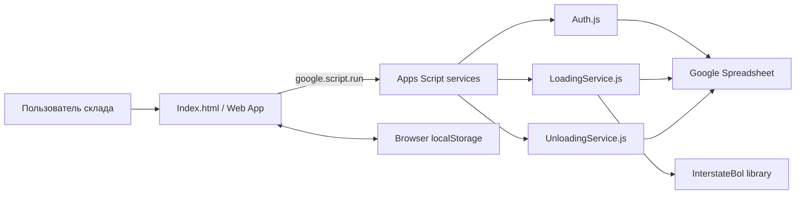

# Текущая система Warehouse Control Platform

## 1. Назначение и границы

`warehouse-control-platform` — внутреннее Google Apps Script Web App для межскладских операций между NY и CA.

Фактически реализованы:

- аутентификация по листу `Users`;
- выбор одного из четырёх workflow: NY/CA Loading и NY/CA Unloading;
- выбор транспорта;
- загрузка заказов на уровне заказа или отдельных pieces;
- локальное хранение несохранённых изменений Loading в браузере;
- формирование снимка рейса в `TripReports`;
- уведомление отдельного Interstate BOL сервиса после создания рейса;
- поиск открытого рейса по направлению;
- сверка pieces при выгрузке;
- закрытие рейса с записью `Receiving` и созданием строк `Missing`.

Не реализованы: Pickup, Delivery, фотографии, документы, фоновая синхронизация, разрешение конфликтов и полноценная работа приложения без первоначальной загрузки Web App.

Текущий скрипт является источником подтверждённой бизнес-логики, но не целевой архитектурой будущего мобильного приложения.

## 2. Пользователи и роли

Отдельной сущности Role нет. Права задаются списком workflow в поле `Users.Access`.

| Участник | Фактические возможности |
| --- | --- |
| Сотрудник NY | `NY_LOADING` и/или `NY_UNLOADING` |
| Сотрудник CA | `CA_LOADING` и/или `CA_UNLOADING` |
| Администратор | Любая комбинация четырёх workflow; специальных административных экранов нет |

Активность контролируется `Users.Active`. Имя пользователя записывается в отчётные строки. Пароли хранятся открытым текстом.

Ограничение: после `login()` серверная сессия не создаётся. Браузер хранит username и выбранный workflow в `localStorage`, а серверные write-методы повторно проверяют только наличие активного пользователя и доступ к workflow.

Web App может быть опубликован с широким Google-level доступом; фактическое ограничение workflow в MVP выполняется через внутренний login и `Users.Access`.

## 3. Конфигурация процессов

Конфигурация находится в `Config.js`.

| Workflow | Режим | Откуда | Куда | Orders | Pieces |
| --- | --- | --- | --- | --- | --- |
| `NY_LOADING` | loading | NY | CA | `Orders_NY` | `OrderPieces_NY` |
| `CA_LOADING` | loading | CA | NY | `Orders_CA` | `OrderPieces_CA` |
| `NY_UNLOADING` | unloading | CA | NY | — | — |
| `CA_UNLOADING` | unloading | NY | CA | — | — |

Все workflow используют общие листы `TripReports`, `Receiving` и `Missing`. Доступный транспорт:

- `Truck 1 (26 ft)`;
- `Truck 2 (16 ft)`;
- `Extra 26 ft`.

Время операций форматируется в `America/New_York`.

## 4. Модули и ответственность

| Файл | Ответственность |
| --- | --- |
| `Code.js` | Точка входа Web App, initial data, создание support sheets, подключение Spreadsheet |
| `Config.js` | Spreadsheet ID, timezone, transport, workflow и направления |
| `Auth.js` | Login, чтение `Users`, проверка Active и доступа к workflow |
| `LoadingService.js` | Чтение Orders, piece tracking, сохранение Loading, создание `TripReports`, общие helpers Sheets |
| `UnloadingService.js` | Поиск и чтение рейсов, Close Trip, `Receiving`, `Missing` |
| `Index.html` | Весь UI, состояние браузера, localStorage queue/cache, вызовы `google.script.run` |
| `appsscript.json` | V8 runtime, timezone, OAuth scopes, pinned `InterstateBol` library |

Разделение по Loading/Unloading понятно для MVP. При этом `LoadingService.js` также содержит общие функции работы с листами, датами и заголовками.

## 5. Внешние зависимости

- Google Apps Script V8.
- `HtmlService` для Web App.
- `SpreadsheetApp` как единственное серверное хранилище.
- `LockService` для Generate Trip и Close Trip.
- `Utilities.formatDate()` для дат и идентификаторов.
- `google.script.run` для browser-to-server RPC.
- Browser `localStorage` для сессии, кэша Orders/Pieces и pending queue.
- Apps Script library `InterstateBol` для постановки созданного TripID в очередь генерации BOL.

Прямых HTTP-вызовов из Warehouse Control code нет; BOL-обработка выполняется отдельной подключённой библиотекой. Ошибка уведомления BOL логируется и возвращается в результат, но не откатывает уже созданный `TripReports`.

## 6. Google Spreadsheet

Spreadsheet ID зафиксирован в `Config.js`. Используются листы:

| Лист | Назначение | Создание |
| --- | --- | --- |
| `Users` | Учётные данные и workflow access | Создаётся автоматически |
| `Orders_NY` | Исходные заказы NY для Loading | Должен существовать |
| `Orders_CA` | Исходные заказы CA для Loading | Должен существовать |
| `OrderPieces_NY` | Состояние отдельных pieces NY | Создаётся автоматически |
| `OrderPieces_CA` | Состояние отдельных pieces CA | Создаётся автоматически |
| `OrderLoadingState` | PiecesTotal по ключу Branch + OrderID | Создаётся автоматически |
| `TripReports` | Append-only снимки сформированных рейсов | Создаётся автоматически |
| `Receiving` | Результаты закрытых Unloading trips по заказам | Создаётся автоматически |
| `Missing` | Отдельная строка на каждую отсутствующую piece | Создаётся автоматически |

`ensurePlatformSetup()` проверяет/создаёт support sheets. Если ожидаемые заголовки support sheet отличаются, текущий код перезаписывает строку заголовков.

Полный контракт колонок приведён в [DATA_MODEL.md](DATA_MODEL.md).

## 7. Схема взаимодействия

Основной поток:

1. Web App получает публичную конфигурацию.
2. Пользователь входит по username/password.
3. UI сохраняет выбранный контекст в `localStorage` на 12 часов.
4. Loading читает Orders, OrderLoadingState, OrderPieces и TripReports.
5. Pending Loading changes сохраняются локально и затем отправляются на сервер.
6. Generate Trip добавляет строки в `TripReports`.
7. Для полностью отправленных строк и пустых строк без OrderID очищается legacy-значение `Pieces` в Orders; состояние по OrderID сохраняется в OrderLoadingState.
8. После успешной записи TripReports Warehouse Control вызывает `InterstateBol.enqueueInterstateBolTrip(TripID, Route)`.
9. Unloading выбирает незакрытый TripID по направлению.
10. Close Trip добавляет строки в `Receiving`, затем `Missing`.

## 8. Локальное хранение и «offline-friendly» поведение

Фактически реализовано:

- кэш последнего ответа Loading Orders;
- кэш открытых Pieces;
- очередь несохранённых `piecesInputs`, `unknownUpdates`, `pieceUpdates`;
- повторная ручная отправка после ошибки;
- показ кэша после 12-секундного backend timeout;
- предупреждение перед logout/change workflow при pending Loading changes.

Не реализовано:

- Service Worker и гарантированный запуск приложения без сети;
- локальная БД и хранение фотографий;
- фоновая очередь синхронизации;
- стабильный идентификатор каждой операции;
- server-side идемпотентность;
- versioning записей и разрешение конфликтов;
- локальная очередь Unloading/Close Trip.

Поэтому текущую реализацию нельзя считать полноценным offline-first решением.

## 9. Подтверждённые ограничения

- Browser session не является серверной authenticated session.
- Google-level Web App access не заменяет внутреннюю проверку `Users`; текущая безопасность MVP зависит от простого login/password в Spreadsheet.
- `saveLoadingChanges()` сериализует изменения общим script lock, но записи в несколько листов не являются транзакцией Google Sheets.
- `OrderPieces` при сохранении читается и записывается целиком.
- `Receiving` и `Missing` записываются последовательно, не как единая восстанавливаемая операция.
- TripID/ReceivingID имеют точность до минуты.
- PiecesTotal сохраняется в `OrderLoadingState` по Branch + OrderID; count-only LoadedPieces — в `OrderPieces_*` по OrderID и PieceNumber. Номер строки Orders используется только в UI и не является ключом сохранения.
- Фотографии и ссылки на них отсутствуют.
- Есть минимальный локальный unit test для BOL notification; полного тестового покрытия и формального API-контракта нет.
- Добавление склада требует новых workflow, листов Orders/OrderPieces и изменения setup-кода.

Эти ограничения нужно учитывать как риски и исходные данные, а не переносить механически в будущее приложение.
