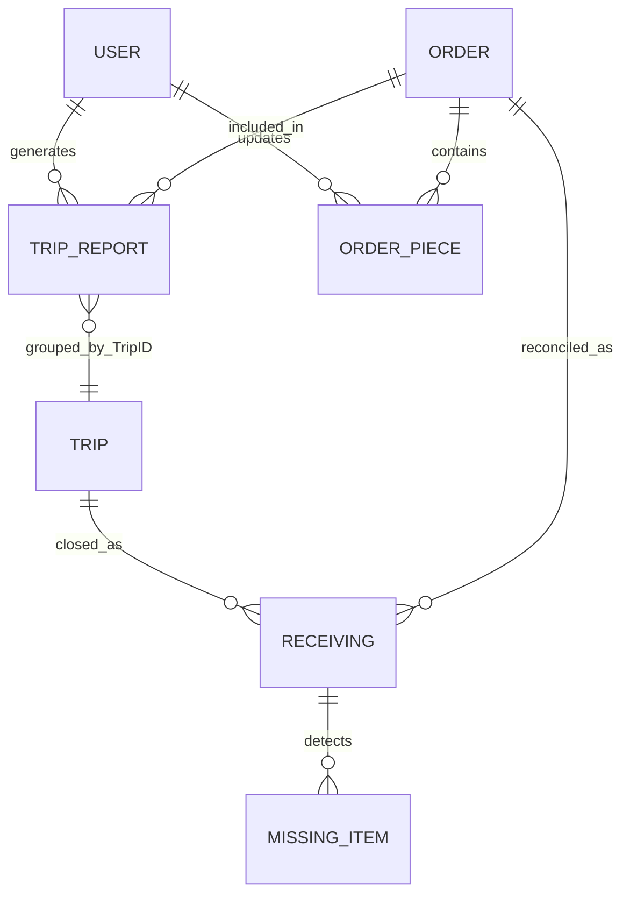

# Модель данных

## 1. Правила чтения документа

- **Фактическая сущность** — существует в коде или Google Sheets.
- **Производное поле** — рассчитывается, но отдельно не хранится.
- **Требование к будущей модели** — сущность нужна заявленному мобильному scope, но её поля ещё не определены.
- Типы указаны логически; Google Sheets физически не обеспечивает строгие типы и ограничения.

## 2. Фактические сущности Google Sheets

### 2.1 User — лист `Users`

| Поле | Тип | Обяз. | Источник / правило |
| --- | --- | ---: | --- |
| Username | string | Да | Вводится вручную; поиск без учёта регистра |
| Password | string | Да | Вводится вручную; хранится открытым текстом |
| Access | string[] | Да | CSV из ключей workflow |
| Active | boolean-like | Да | `TRUE`, `yes`, `1` считаются true |

Связи: User выполняет Loading/Unloading и записывается в TripReports, Receiving, Missing, OrderPieces.

Уникальность Username кодом не обеспечивается; используется первая найденная строка.

### 2.2 Order — `Orders_NY`, `Orders_CA`

Листы являются внешним источником заказов. Код поддерживает aliases.

| Логическое поле | Поддерживаемые заголовки | Тип | Обяз. | Использование |
| --- | --- | --- | ---: | --- |
| orderId | `OrderID`, `ID` | string | Да | Идентификация и связи |
| title | `Title` | string | Нет | UI и отчёты |
| excl | `Excl` | unknown | Нет | Распознаётся, но не используется |
| zone | `DeliveryZone`, `Delivery Zone`, `Zone` | string | Нет | UI |
| volume | `Volume` | number | Нет | Статистика и TripReports |
| deliveryDate | `DeliveryDate`, `Delivery date`, `Date` | date/string | Нет | UI и TripReports |
| count | `Count` | unknown | Нет | Распознаётся, но не используется |
| colorCode | `ColorCode`, `Color` | `1/2/3` или red/yellow/green | Да | Фильтрация строки и группировка |
| weight | `Weight` | number | Нет | Статистика и TripReports |
| loaded | `Loaded` | unknown | Нет | Распознаётся, но не используется |
| piecesTotal | `PiecesTotal`, `Pieces` | positive integer | Нет | Выбор piece-level режима |
| loadedPieces | `LoadedPieces` | non-negative integer | Условно | Используется только без PiecesTotal |

Строка без orderId или валидного colorCode не входит в приложение.

Ключ фактически предполагается как `Branch + OrderID`, но уникальность строк Orders не проверяется.

### 2.3 Cargo Item / Piece — `OrderPieces_NY`, `OrderPieces_CA`

| Поле | Тип | Обяз. | Источник / правило |
| --- | --- | ---: | --- |
| Branch | string | Да | Workflow config |
| OrderID | string | Да | Order |
| PieceNumber | positive integer | Да | Генерируется `1..PiecesTotal` или приходит в update |
| Loaded | boolean | Да | Действие пользователя |
| LoadedAt | datetime/string | Нет | Первый переход в Loaded; очищается при unload toggle |
| UpdatedAt | datetime/string | Да | Последнее сохранение состояния |
| LoadedBy | string | Нет | Username последнего изменения |
| TripID | string | Нет | Поле создано и читается, но текущий код его не записывает |

Предполагаемый уникальный ключ: `Branch + OrderID + PieceNumber`. Sheets constraint отсутствует.

При уменьшении PiecesTotal старые rows не удаляются. Загруженные pieces выше нового total всё ещё могут читаться.

### 2.4 Trip / Loading snapshot — `TripReports`

Trip не имеет отдельной master row. Он представлен группой rows по TripID; каждая строка — часть одного Order в конкретной генерации.

| Поле | Тип | Обяз. | Источник |
| --- | --- | ---: | --- |
| TripID | string | Да | `{tripPrefix}-{yyMMdd-HHmm}` |
| GeneratedAt | datetime/string | Да | Server time |
| Branch | string | Да | Loading config |
| Route | string | Да | Loading config |
| User | string | Да | Переданный username |
| Truck | string | Да | Выбор пользователя |
| OrderID | string | Да | Order |
| Title | string | Нет | Snapshot Order.Title |
| Weight | number | Нет | Snapshot Order.Weight |
| Volume | number | Нет | Snapshot Order.Volume |
| LoadingDate | string | Нет | Текущий код всегда записывает пустое значение |
| DeliveryDate | date/string | Нет | Snapshot |
| PiecesTotal | positive integer | Нет | Snapshot |
| LoadedPieces | non-negative number | Да | Новая, ранее не reported часть |
| RemainingPieces | number/string | Нет | Остаток; пусто при неизвестном total |
| Status | enum | Да | `Started`, `Completed` |
| CountPieces | CSV integers | Нет | Номера pieces текущей генерации |
| RemainingCountPieces | CSV integers | Нет | Ещё не included номера |
| Departure Warehouse | string | Да | Config |
| Destination Warehouse | string | Да | Config |

Связи: TripReports создаётся из Orders/OrderPieces и является источником Unloading.

TripID не гарантированно уникален: точность генерации — одна минута.

После создания строк Warehouse Control передаёт `TripID` и `Route` во внешнюю библиотеку `InterstateBol`. BOL queue, registry, PDF URL и lifecycle BOL хранятся не в Warehouse Control spreadsheet, а в отдельном BOL-сервисе.

### 2.5 Unloading result — `Receiving`

Одна строка создаётся для каждого Order row выбранного TripID.

| Поле | Тип | Обяз. | Источник |
| --- | --- | ---: | --- |
| ReceivingID | string | Да | `{unloadingPrefix}-{yyMMdd-HHmm}` |
| ReceivedAt | datetime/string | Да | Server time |
| Branch | string | Да | Destination workflow |
| Mode | string | Да | `unloading` |
| Route | string | Да | Config |
| User | string | Да | Username |
| Truck | string | Нет | Payload либо TripReports |
| TripID | string | Да | Выбранный Trip |
| OrderID | string | Да | TripReports |
| Title | string | Нет | TripReports |
| ExpectedPieces | number | Да | TripReports.LoadedPieces |
| ReceivedPieces | number | Да | Число отмеченных pieces |
| MissingPieces | number | Да | Число неотмеченных expected pieces |
| ReceivedCountPieces | CSV integers | Нет | Отмеченные номера |
| MissingCountPieces | CSV integers | Нет | Неотмеченные номера |
| Status | enum | Да | `Received`, `Missing`, `Partially received` |
| ClosedAt | datetime/string | Да | Совпадает с ReceivedAt |
| Departure Warehouse | string | Да | Trip/config |
| Destination Warehouse | string | Да | Trip/config |

Предполагаемая идентичность результата: `TripID + OrderID`, но constraint отсутствует. Наличие любой строки подходящего TripID используется как признак закрытого trip.

### 2.6 Missing Item — `Missing`

| Поле | Тип | Обяз. | Источник |
| --- | --- | ---: | --- |
| MissingID | string | Да | `{ReceivingID}-{OrderID}-{PieceNumber}` |
| DetectedAt | datetime/string | Да | Close Trip time |
| Branch | string | Да | Destination branch |
| User | string | Да | Username |
| TripID | string | Да | Trip |
| OrderID | string | Да | Order |
| Title | string | Нет | TripReports |
| PieceNumber | positive integer | Да | Expected minus received |
| IssueType | string | Да | Всегда `Missing` |
| Note | string | Нет | Всегда пусто при создании |
| Status | string | Да | Всегда `Open` при создании |

Процессы изменения Note/Status или разрешения Missing отсутствуют.

## 3. Browser-local данные

| Объект | Состав | Жизненный цикл |
| --- | --- | --- |
| Session | username, workflow snapshot, truck, savedAt | TTL проверяется клиентом: 12 часов |
| Orders cache | cachedAt, последний Loading response | Заменяется после успешной загрузки |
| Pieces cache | данные открытых orders | Заменяется/очищается клиентом |
| Pending queue | pieceUpdates, unknownUpdates, piecesInputs | Хранится до success handler Save |

Это не синхронизационная модель: operation ID, version, retry count, server acknowledgement и conflict state отсутствуют.

## 4. Связи текущей модели

`TRIP` на диаграмме — логическая группировка, а не отдельный лист.

## 5. Сущности будущего приложения

Ниже фиксируется только необходимость сущностей. Недостающие поля должны быть определены до wireframe или при детальном проектировании.

| Сущность | Что подтверждено текущей системой | Что требуется определить |
| --- | --- | --- |
| Order | ID, title, warehouse/branch context, weight, volume, dates, pieces | Полный жизненный цикл Pickup/Delivery, адреса, контакты, version |
| Pickup | Не реализован | ID, assignment, checkpoints, result, exceptions, timestamps |
| Delivery | Не реализован | ID, proof, result, exceptions, receiver confirmation |
| Trip | Логически существует через TripID, route, truck, orders | Master record, lifecycle, assignment, reopen/cancel rules |
| Loading | Piece/count state и snapshot TripReports | Отдельная operation/event identity, status history, version |
| Unloading | Expected/received/missing и Close Trip | Draft, resume, correction, multi-user merge |
| Cargo Item / Piece | OrderID + PieceNumber, Loaded | Стабильный глобальный ID/label, condition, scan identifiers |
| Missing Item | Piece, trip, order, Open | Resolution workflow, reason taxonomy, owner, audit history |
| Photo | Отсутствует | Связь с процессом/сущностью, local ID, file metadata, sync state |
| Warehouse | NY/CA заданы строками config | ID, name, timezone, allowed workflows |
| Truck | Три строки config | ID, label, type/capacity, active state |
| User | Username, access, active | Stable ID, roles/permissions, secure authentication |
| Sync Operation | Отсутствует | Operation ID, entity, payload/version, state, retries, errors |

### 5.1 Карточки неподтверждённых сущностей

Для сущностей ниже типы и обязательность полей нельзя утверждать по текущему коду.

| Сущность | Назначение | Подтверждённые поля/источник | Связи | ID и статусы | Фото |
| --- | --- | --- | --- | --- | --- |
| Pickup | Зафиксировать получение груза у отправителя | Нет; должен появиться из будущего assignment/process contract | Order, Cargo Item, User; точные cardinality открыты | Не определены | Требуются scope и обязательность |
| Delivery | Зафиксировать передачу груза получателю | Нет; должен появиться из будущего delivery contract | Order, Cargo Item, User; получатель не смоделирован | Не определены | Требуются proof rules |
| Photo | Хранить визуальное подтверждение или исключение | Нет | Должна ссылаться на Pickup/Delivery/exception; допустимые связи открыты | Нужны local и server identity; upload states | Это сама media entity; metadata/retention открыты |
| Warehouse | Стабильный справочник мест выполнения операций | Сейчас только строки `NY`/`CA` в config | Workflow, User, Trip | ID/status не определены | Не требуется текущим scope |
| Truck | Стабильный транспорт вместо строк UI | Сейчас только три label в config | Trip/assignment | ID/status не определены | Не требуется текущим scope |
| Sync Operation | Прослеживать и безопасно повторять локальную команду | Нет | Любая изменяемая сущность и связанные media | Operation ID обязателен как требование; точные состояния перечислены ниже | Должна включать/связывать upload operations |

Для уже существующих логических сущностей будущая модель должна сохранить бизнес-смысл, но не текущую физическую форму:

| Сущность | Назначение | Источник сейчас | Требования к идентичности/обновлению | Статусы и фото |
| --- | --- | --- | --- | --- |
| Order | Единица планирования Pickup/Delivery/Interstate | `Orders_*` | Нужен стабильный ID и version; source of truth открыт | Текущие Loading statuses производные; фото не связаны |
| Trip | Группа межскладского груза и операций | Группа `TripReports` по TripID | Нужна отдельная identity и lifecycle; rules correction открыты | Сейчас формального Trip status нет; фото не связаны |
| Loading | Фиксация фактически загруженного груза | Orders, OrderPieces, TripReports | Нужен operation ID и audit-safe updates | `Requires Pieces`, `Not Started`, `Started`, `Completed`; фото отсутствуют |
| Unloading | Сверка ожидаемого и полученного груза | TripReports, Receiving | Нужны draft identity, version и idempotent close | UI: Not received/Partial/Received; persisted: Received/Missing/Partially received |
| Cargo Item / Piece | Отдельное физическое грузовое место | `OrderPieces_*` или count fallback | Нужен ответ о global ID/label и count-only режиме | Loaded boolean; condition/exception/photo links не определены |
| Missing Item | Зафиксировать неполученное место | `Missing` | Нужен стабильный ID и correction/resolution history | Сейчас только `Open`; фото отсутствуют |
| User | Исполнитель и субъект прав | `Users` | Нужен стабильный ID и безопасная authentication identity | Active существует; role model и фото не нужны/не определены |

## 6. Данные, необходимые для offline-first

Это требования, а не текущие поля:

- стабильный ID каждой локальной команды и создаваемой сущности;
- локальный timestamp и server timestamp;
- version/revision синхронизируемой записи;
- состояния `local`, `queued`, `syncing`, `synced`, `conflict`, `failed`;
- retry count и последняя ошибка;
- связь фото с локальной бизнес-записью до получения server ID;
- server acknowledgement, позволяющий безопасно повторить запрос;
- признак soft delete и запрет удаления несинхронизированных данных;
- audit information для конфликтов и исправлений.

Конкретный состав payload и стратегия merge остаются открытыми вопросами.
